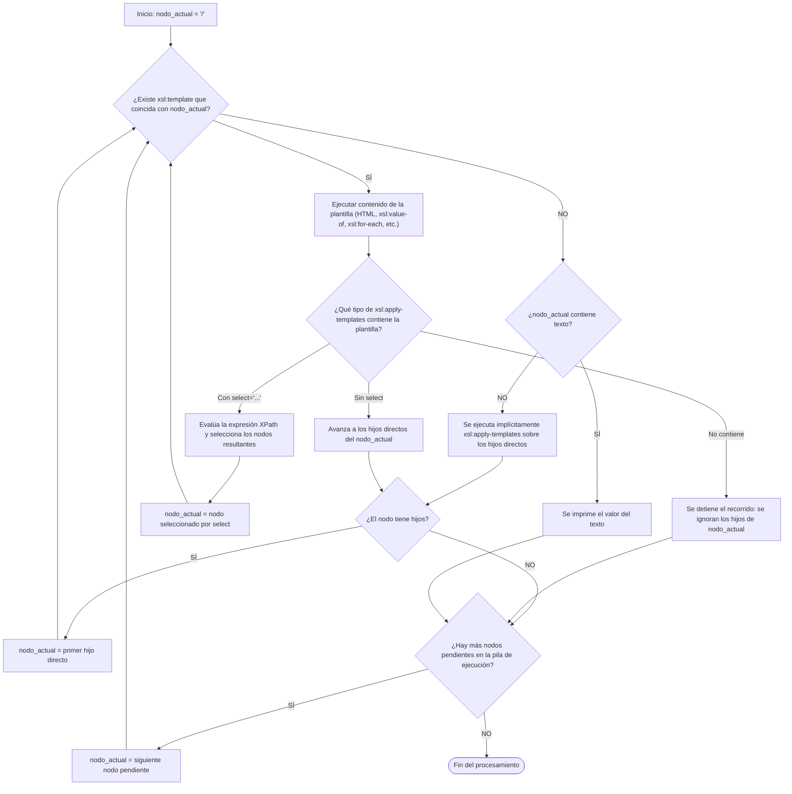

# XSLT Teoría

[Tutorial de Eniun de XSLT](https://www.eniun.com/tutorial-xslt/).

De este tutorial, solo vamos a ver el elemento **`6.1. Elemento <xsl:value-of>`** y ninguno otro.

## Ejercicios para practicar

[Descárgate este fichero](biblioteca-xslt.zip).

Descomprímelo y abre la carpeta descomprimida con Visual Studio Code.

## Esquema de cómo funciona `<xsl:template>`



## Diferentes salidas para `<xsl:stylesheet>`

Texto plano

```xml
<xsl:output method="text" encoding="UTF-8"/>
```

HTML

```xml
<xsl:output method="html" encoding="UTF-8" indent="yes"/>
```

XML

```xml
<xsl:output method="xml" encoding="UTF-8" indent="yes"/>
```

